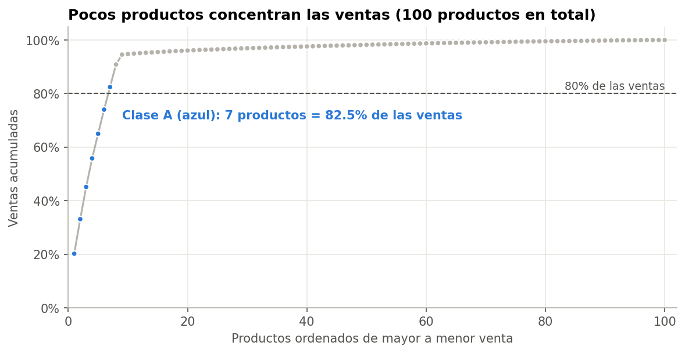
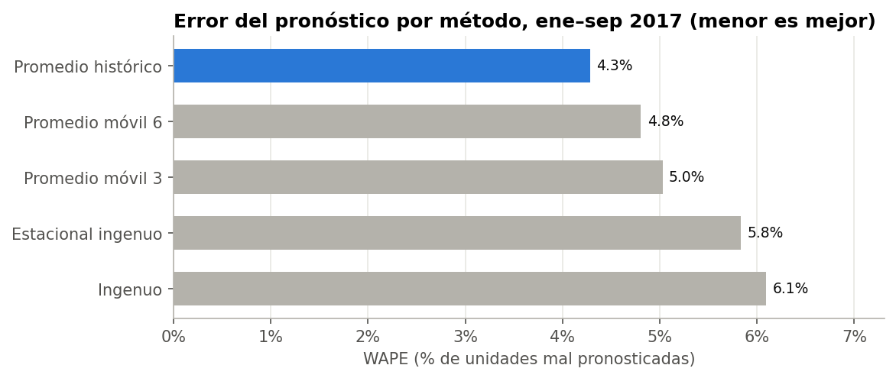

# DataCo Demand Forecasting and Reorder Points with Python

**English** · [Español](README.es.md)

**Case study with public data** · Python (pandas, matplotlib) · Rafael Adonay Rocha Gutiérrez

## Scenario

Simulated role: inventory planning analyst at DataCo, a company selling sporting goods, apparel and electronics across 5 markets. In my [SQL analysis](https://github.com/rafaeladonay7-design/dataco-sql) I found that a handful of products generate most of the sales. The planning manager asks:

1. Which products concentrate sales and need continuous inventory control?
2. Which forecasting method works best for them?
3. How much safety stock is needed, and at what point should we reorder, for a 95% service level?

**Full analysis:** [`analisis_inventario.ipynb`](analisis_inventario.ipynb) (code, tables and charts; notebook written in Spanish).

## Data

[DataCo Smart Supply Chain for Big Data Analysis](https://www.kaggle.com/datasets/shashwatwork/dataco-smart-supply-chain-for-big-data-analysis) (Kaggle): 180,519 order lines, January 2015 to January 2018.

## Data preparation

- The CSV is Latin-1 encoded. Dates come as `M/D/YYYY H:MM` text and are parsed with `pd.to_datetime`.
- From October 2017 monthly units drop from ~11,000 to ~2,000, so I use **January 2015 to September 2017** (33 full months).
- Canceled and suspected-fraud orders (7,754 lines) are removed: they are not demand to be fulfilled.
- Daily demand includes days with zero sales, so variability is not underestimated.

## Key findings

| # | Finding | Result |
|---|---|---|
| 1 | Concentration | **7 products (7%)** generate **82.5%** of sales |
| 2 | Stability | Monthly demand for class A varies only **4% to 8%** (coefficient of variation), with no trend or seasonality |
| 3 | Forecasting | The **historical average** has the lowest error (**4.3%** WAPE) vs 6.1% for the naive method, and wins in 5 of 7 products |
| 4 | Safety stock | At 95% service and a 7-day lead time, **304 units (~$31,000)** are enough: 1 to 1.5 days of demand per product |
| 5 | Biggest driver | A 30-day supplier lead time instead of 7 **doubles** safety stock (+107%); raising service from 95% to 99% adds 42% |





## Method

- **ABC classification:** A = first 80% of sales, B = next 15%, C = last 5%. With canceled/fraud orders and incomplete months removed, class A has 7 products instead of the 8 in the SQL project.
- **Forecast backtest:** for each month from January to September 2017, each method forecasts using only prior months. Compared: naive, 3- and 6-month moving average, seasonal naive, historical average. Error metric: WAPE (sum of absolute errors / actual demand).
- **Safety stock:** SS = z × σ(daily demand) × √LT; reorder point = average daily demand × LT + SS; z = 1.645 for 95%.
- **Sensitivity:** safety stock value for 90/95/99% service and 7/14/30-day lead times.

## Recommendations

1. **Continuous review for the 7 class A products** using the reorder points in section 5 of the notebook. Classes B and C can use periodic review.
2. **Forecast with the historical average** and track the error monthly. A more complex model is not justified for demand this stable; if the error goes above ~10%, check whether the pattern changed.
3. **Measure and negotiate supplier lead times** before raising the service level. It is the variable that moves inventory the most, and it is not recorded today.

## Limitations

- The 7-day lead time is an assumption; the dataset has no supplier data.
- Safety stock only covers demand variability, not lead-time variability.
- Inventory is valued at selling price because the dataset has no unit cost.
- Demand is more stable than usual in real data, which suggests the dataset is partly simulated.

## How to run it

```bash
python3 -m venv .venv && source .venv/bin/activate
pip install -r requirements.txt
# Download DataCoSupplyChainDataset.csv from Kaggle into data/
jupyter notebook analisis_inventario.ipynb
```
